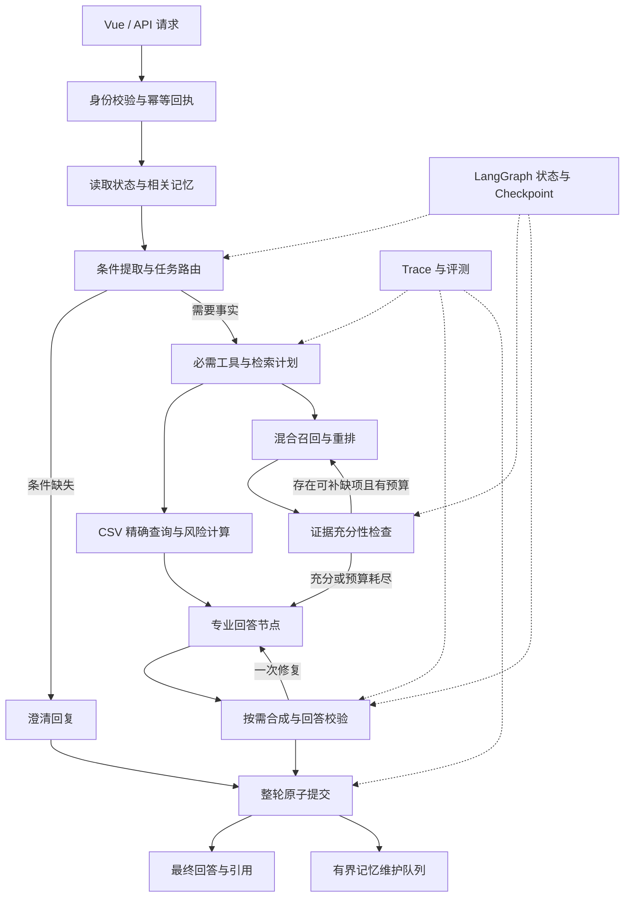

# HelloHebut 精进方案：可验证的招生咨询 Agent

日期：2026-11-11。状态：在 `v2` 分阶段实施，已交付范围与实测结果见 [v2 实施与验证指南](experiments/v2/README.md)；本文仍是完整设计目标，预算、指标和工期不代表全部已实现或已达标。

阶段简报单独维护在 [v2 阶段更新](experiments/v2/STAGE_UPDATES.md)。每批工作完成后更新简报并暂停供用户审查，再根据反馈继续；本文不重复堆叠实施日志。

依据：[项目技术现状](TECHNICAL_DESIGN.md)、[主要流程](main_flow.md)、[Agent 调研交接材料](agent_research_codex_context_2026-11.txt)，以及本地 EchoMind Python 源码和 Java 版中经筛选的可迁移设计。调研材料已替代无法抓取正文的 ChatGPT 分享链接。方案基于 HelloHebut 提交 `d650853`，不重复现有部署说明和算法细节。

## 1. 推荐路线与预期成果

将项目升级为**能判断证据是否充分、能正确继承和修正用户条件、能追踪与恢复执行过程的招生咨询系统**。保留 Python、FastAPI、Vue、Chroma、Redis 与 CSV 确定性计算，渐进引入 Agentic RAG、结构化记忆、LangGraph 和评测追踪。

业务优先级为 **Agentic RAG → 可验证记忆 → 持久工作流 → Skills 与协作优化**；基线评测、Trace、权限和请求幂等从第一阶段贯穿实施。先把咨询链路做扎实，再用独立实验判断复杂技术是否值得保留。

完成后的三个代表性能力：

| 场景 | 目标行为 | 可证明的技术能力 |
| --- | --- | --- |
| “比较两个年份、两个专业的报考要求” | 拆解问题、按年份取证、补查缺项、逐条引用；缺某年资料时明确指出 | 多跳检索、时间过滤、证据充分性判断 |
| “河北物理类位次 12000，计算机和电气怎么选？那如果换天津考生呢？” | 分开查询两个专业；更换省份后重新确认成绩条件，避免沿用旧位次 | 结构化状态、确定性工具、冲突处理 |
| 请求超时、重复发送、服务重启 | 识别同一请求，返回已有结果或恢复可恢复节点，不重复写入整轮对话 | 任务账本、Checkpoint、幂等提交 |

建议第一版只做“受控工作流 + 有界工具循环”。LangGraph 负责状态转移与恢复，模型在允许的工具和预算内决定补查什么。Deep Agents 适合另行实验长篇政策研究任务，其规划、子 Agent、文件系统上下文等能力无需全部进入在线问答链路。[Deep Agents 官方说明](https://docs.langchain.com/oss/python/deepagents/overview)

## 2. 从现状出发，借鉴 EchoMind 的哪些部分

下表中的“已有”来自源码核对；调研材料对 HelloHebut 的概括不能替代实现事实。Java 版仅保留混合检索、回答校验、上下文预算三项可借鉴方法，均在 HelloHebut 现有 Python 技术栈中实现。

| 能力 | HelloHebut 当前实现与缺口 | EchoMind 可借鉴实现 | 本项目落点 |
| --- | --- | --- | --- |
| 工具调用 | ChatService 预先调用工具，Agent 没有模型驱动的工具循环；CSV 只由主意图触发 | Python 的 `tool_use/tool_result` 循环、角色工具范围、Schema 与重试属性 | 必需事实由程序保证，补充检索允许模型选择 |
| 多角色协作 | 关键词决定并行角色，成功回答直接拼接 | `RoutingDecision`、主辅角色、`ResponseComposer` | 结构化分工、去重合成、冲突显式处理 |
| 会话状态 | 临时实体与历史文本补字段，缺少显式任务状态 | `core/conversation_state.py` 的字段来源与任务切换 | 招生条件分层、来源可追溯、条件变更规则 |
| 并发与可靠性 | 用户/助手消息分开写入，摘要失败仍可能裁剪，画像任务无队列上限 | `commit_turn`、会话锁/Redis 租约、WATCH/MULTI 压缩、有限后台队列 | 整轮原子提交、压缩失败保留原文、受控异步维护 |
| 检索 | 已有改写、混合召回、RRF 和 LLM 重排；没有证据驱动的迭代检索 | Python 工具化 RAG；Java 版的语义召回与 BM25 双通道思路 | 保留现有 RRF，以 BM25 对照词法召回，并增加规划与证据核验 |
| 回答校验 | 清理引用编号，尚不判断“引用是否支持结论” | Java 版的独立校验节点、类型化校验结果、校验异常不放行 | Python 中先做数字/年份硬校验，再核验证据；最多修复一次 |
| 上下文预算 | Skills 按字符截断，多角色共享大段背景 | Java 版的完整请求预算、整轮裁剪、工具结果结构化限长；Python 角色上下文 | 使用适配模型的计数方式，保留当前问题和工具交互完整性 |
| MCP | `mcp/` 只是本地目录，未实现标准协议 | Python `tooling/mcp_client.py`、`mcp_server.py` | 有跨服务复用需求时接入标准 MCP |
| 评测 | 同业务链路评测、LLM Judge、硬断言；缺轨迹与完整实验元数据 | Judge 校准样例、工具断言、评测指纹 | 增加检索、记忆、工具轨迹、恢复与成本评测 |

借鉴时保留以下边界：EchoMind 的 BGE-M3 客户端用于**意图匹配**，不能直接视为其 Python RAG 已升级；Python 评测 Job 保存在进程内，不具备重启恢复。它的工具也不能证明已接入真实退款、工单等外部写操作。

本地代码入口（EchoMind 位于同级工作区，以下引用适用于本地阅读；HelloHebut 远程仓库不包含这些源码）：

- Python：[角色编排与 Composer](../EchoMind所有代码+详细文档+简历/EchoMind/agents/agent_orchestrator.py)、[工具定义](../EchoMind所有代码+详细文档+简历/EchoMind/agents/tools.py)、[状态合并](../EchoMind所有代码+详细文档+简历/EchoMind/core/conversation_state.py)、[并发控制](../EchoMind所有代码+详细文档+简历/EchoMind/core/concurrency.py)、[整轮提交与压缩](../EchoMind所有代码+详细文档+简历/EchoMind/memory/conversation_memory.py)。
- 协议与评测：[MCP Client](../EchoMind所有代码+详细文档+简历/EchoMind/tooling/mcp_client.py)、[评测器](../EchoMind所有代码+详细文档+简历/EchoMind/evaluation/evaluator.py)、[进程内评测 Job](../EchoMind所有代码+详细文档+简历/EchoMind/evaluation/jobs.py)。
- 保留的 Java 方法参考：[混合检索](../EchoMind所有代码+详细文档+简历/EchoMindJava/src/main/java/com/echomind/knowledge/KnowledgeBaseService.java)、[独立回答校验](../EchoMind所有代码+详细文档+简历/EchoMindJava/src/main/java/com/echomind/agent/AnswerVerifier.java)、[请求预算与完整轮次裁剪](../EchoMind所有代码+详细文档+简历/EchoMindJava/src/main/java/com/echomind/llm/PromptBudget.java)。

## 3. 目标架构与数据职责



图中多角色、补检索、修复都是条件分支；寒暄和简单确定性查询走短路径。证据不足可以产出带缺项说明的部分回答，不能把“用完预算”视为证据充分。

| 数据 | 推荐归属 | 边界 |
| --- | --- | --- |
| 官方政策、专业资料、历史录取数据 | 版本化资料目录 + Chroma；CSV 保留结构化查询 | 政策与数字的事实依据，不被用户画像覆盖 |
| 当前考生条件、待澄清项、任务步骤 | 结构化 TaskState；后续由 Checkpointer 持久化执行快照 | 当前任务条件与长期偏好分离 |
| 已确认偏好、历史任务经验 | PostgreSQL 记录事实与版本；Chroma 可作派生检索索引 | 权限、有效期、撤销以关系记录为准 |
| 已提交对话、请求回执、评测任务 | 第一版复用 Redis；持久化阶段统一迁入 PostgreSQL | 明确单一权威写入端，避免 Redis/PG 双写各自认定成功 |
| 缓存、限流、短期锁与队列 | Redis | 缓存丢失不能改变已确认事实或已提交结果 |
| 调用轨迹与质量指标 | Langfuse + 现有 Prometheus | 记录结构化过程，默认脱敏，不保存模型隐藏思考过程 |

先保留 Chroma，避免同时更换向量库；引入 PostgreSQL 是为了记忆版本、任务账本和 Checkpoint。暂不同时安装 pgvector、Qdrant、Mem0、Hindsight。LangGraph 的 Checkpointer 与跨线程 Store 职责不同，接入时必须区分执行快照和长期事实。[LangGraph 持久化文档](https://docs.langchain.com/oss/python/langgraph/persistence)

## 4. 核心模块怎么改

### 4.1 Agentic RAG：由“检索一次”升级为“按缺失证据补查”

**输入**为问题、已确认条件、子任务、知识版本和剩余预算；**输出**为可引用的证据集合、未解决问题、冲突及停止原因。

1. **规划**：输出类型化子问题，如“2025 年计算机选科要求”“2026 年计算机选科要求”，附年份、专业、学院等过滤条件。简单事实问题直接查询，省去规划模型调用。
2. **召回**：复用现有 Chroma + RRF；将自定义词法匹配与 BM25 做对照，将现有向量模型与 BGE-M3 做中文检索对照。BGE-M3 支持多语言及多种检索表示，但是否适合本项目由本地评测决定。[官方模型卡](https://huggingface.co/BAAI/bge-m3)
3. **重排**：先复用现有 LLM Rerank；有硬件或可用服务时，与 Cross-Encoder 重排比较质量、延迟和费用。首轮尝试召回 20 条、保留最多 8 条，依据证据覆盖调参。
4. **核验**：逐个子问题检查资料年份、适用对象、原文支持和相互冲突；程序先过滤明显错误，模型辅助判断语义支持。
5. **补查或停止**：仅对缺项改写查询；已充分、重复查询无新证据、无对应资料、达到预算均有明确停止路径。Query Planner 接管改写后，关闭工具内部重复扩展，避免查询倍增。

建议的核验结果契约：

```json
{
  "sufficient": false,
  "supported_claims": [
    {"claim_id": "c1", "evidence_ids": ["docA:v2:chunk7"]}
  ],
  "missing_facts": ["2025年该专业的选科要求"],
  "conflicting_sources": [],
  "next_queries": [
    {"query": "计算机科学与技术 选科要求", "filters": {"year": 2025}}
  ],
  "decision": "retrieve_again"
}
```

`evidence_id` 必须由检索结果注册，模型不能自行创建；在答案生成后再次检查“结论—证据”对应关系。CSV 数字、年份和风险等级由程序核验，LLM Verifier 不充当数值真值源。失败时最多修复一次，仍不通过则删除无依据结论并说明资料不足。

**知识治理先于扩大检索**：为资料补充 `document_id/version/year/valid_from/valid_until/source_url/content_hash/ingested_at`。年份、选科、批次等强过滤只在元数据明确时使用；未知值进入待核验池，不伪装成满足条件。URL 属于官方域名不等于正文已核实，入库时记录实际原文和获取时间。

修改切片器，保留标题与表格结构，为长段落增加硬上限和少量重叠；招生表格优先解析为结构化记录，政策叙述保留原文证据。所有导入入口统一“暂存新版本 → 校验 → 切换活动版本 → 缓存代际失效”，避免旧片段残留。更换 Embedding 模型时建立新集合并整体重建，不能混用向量空间。

跨年份能力需要真实的历史资料。现有资料以 2026 年学院介绍和历史 CSV 为主，不能假设已包含完整历年政策；缺少旧政策时，应将相应案例标注为“应拒绝推断”，而不是补写政策。

### 4.2 结构化状态与可验证长期记忆

先定义三组业务字段：`candidate`（省份、科类/选科、分数、位次、考生类型）、`query_scope`（目标年份、批次、专业列表）、`preferences`（兴趣、费用倾向、专业偏好）。每个字段记录来源消息、确认状态和更新时间。

合并规则由代码执行：明确的新值优先；用户纠正使旧值失效；“帮另一个人问”创建新任务；省份、考试模式、目标年份变化时使相关分数/位次及旧计算结果失效并补问。跨会话可继承确认过的偏好，分数位次必须按考生和考试年度绑定，不能作为永久画像自动复用。`target_year` 与 `data_years` 分开，避免把历史比较说成目标年度预测。

| 记忆层 | 保存内容 | 写入与召回规则 |
| --- | --- | --- |
| 工作记忆 | 当前消息、任务条件、已查证据、缺项 | 当前会话状态；压缩保留未解决问题和证据引用 |
| 语义记忆 | 用户明确表达且适合复用的偏好 | 原话可追溯；歧义或模型推测进入候选，不直接激活 |
| 情景记忆 | 历史咨询的条件、结果、失败原因 | 原始执行成功/失败可验证；政策事实使用时重新检查版本 |
| 程序性记忆 | 已验证的咨询流程、查证方法 | 版本化 Skill，经评测和人工审阅发布 |

写入流程为“候选提取 → 来源校验 → 重复与冲突检查 → 激活或待确认”。建议字段：`memory_id/user_id/task_scope/type/key/value/source_message_id/source_run_id/verification_status/status/valid_from/valid_until/version`。`confidence` 若保留，只作辅助排序，不把模型自报分数当真实性概率。

更正时新增版本并标记旧版 `superseded`；到期记忆为 `expired`；删除同步清理检索索引与缓存。模型提炼失败则跳过本次记忆更新，保留原始对话。访问身份由服务端绑定，不能信任请求中的任意 `user_id` 或用 Chroma metadata filter 代替鉴权。

### 4.3 受控工具调用、角色协作与 Context Engineering

新增统一 `ToolSpec`：名称、输入/输出 Schema、允许角色、是否只读、超时、重试属性、结果预算。参数验证使用完整 Schema/Pydantic；所有调用经过 ToolManager，模型不能自行拓宽权限。

先验证当前模型服务是否支持所需工具调用与结构化输出格式；不支持时保留固定编排路径。结构化结果解析失败只进行有限重试，不能把任意自然语言解释成可执行指令。

**纠正当前 CSV 触发条件**：只要子任务需要录取数字或风险比较，就必须执行 `admission_data_query`，不再依赖主意图恰好是 `score_risk`。RiskAgent 解释工具结果，不能自己生成分数、修改计算规则或承诺录取概率。

保留 General、Policy、Risk、Planning 四个角色，但默认单角色，复杂问题最多一个主角色和一个辅助角色。角色接收各自子问题、相关条件和证据，返回 `status/claims/evidence_ids/missing_facts/errors`；Composer 仅在多角色时运行，依据共同证据去重合并，遇到冲突回到核验节点，不能投票决定事实。

上下文分配按“规则 → 当前问题与确认条件 → 必需工具结果 → 相关证据 → 相关记忆”组织。预算覆盖消息、工具 Schema 和工具结果；历史按完整轮次裁剪，保留当前问题与成对工具交互。大输出保存引用与摘要，需要时按段读取；限长后的工具结果须保持合法 JSON，并保留来源标识和截断提示。使用模型适配的 token 计数；无法精确计数时采用保守估算并记录估算方式。此设计借鉴了上下文选择、压缩与按需加载的原则。[Anthropic 上下文工程说明](https://www.anthropic.com/research/effective-context-engineering-for-ai-agents)

初始预算统一由请求级调度器控制，角色与工具不各自无限重试：

| 预算项 | 建议起点 | 耗尽时行为 |
| --- | --- | --- |
| 检索轮数 / 子查询数 | 总计最多 3 轮、6 个子查询 | 返回已有证据及缺项 |
| 工具调用 | 每请求最多 8 次，含必需查询、补查和重试 | 不再发新调用；标明未完成部分 |
| 角色工具循环 | 每角色最多 3 个模型轮次 | 输出已完成的结构化结果 |
| 回答修复 | 最多 1 次 | 保守回答或明确失败 |
| 在线总耗时 | 先以 50 秒硬期限实验，子调用不超过剩余时间 | 取消剩余任务，保存可恢复状态 |
| 上下文 | 每次调用先设 8k 输入 token 上限，并预留输出预算 | 丢弃低相关项；必需事实放不下则拆任务 |

以上数值须按实际模型、服务商限额和评测调整。长篇政策研究另走异步任务接口，不持续扩大 `/chat` 的等待时间。

### 4.4 LangGraph、幂等提交与故障恢复

先将现有 ChatService 各阶段提取成独立函数，再用 LangGraph 连接这些节点，保持相同业务接口和评测入口。`TaskState` 至少保存：任务/请求 ID、状态版本、确认条件、计划、工具结果引用、证据版本、缺项、剩余预算、核验结果、终止状态。

建议节点为：`load_state → parse_and_route → clarify/required_tools → retrieve_and_verify → answer/compose → verify_answer → commit`。普通澄清回复提交后结束本轮，下一条用户消息继续会话；真正需要跨时段审批的任务才使用 `interrupt/resume`。恢复会重入节点，节点前后的外部操作仍需幂等设计。[LangGraph Interrupts](https://docs.langchain.com/oss/python/langgraph/interrupts)

可靠性按以下顺序落实：

1. 请求增加 `client_request_id` 和请求内容哈希；同 ID 同内容回放结果，同 ID 不同内容返回冲突。运行中的重复请求返回任务状态。
2. 借鉴 EchoMind，先在 Redis 原子写入用户消息、最终回答、状态与回执。会话串行化配合租约续期及提交版本检查；失去租约的旧任务不能继续提交。
3. 摘要按消息快照计算，提交时比较版本并保留之后新增消息；摘要失败不裁剪原文。同步 Redis/Chroma 调用改为异步客户端或有界线程池，画像写入使用有限队列。
4. 持久化阶段引入 PostgreSQL：整轮记录、业务状态和回执在一个事务中提交，Redis 转为缓存；Checkpointer 保存执行进度。为存量会话提供版本化迁移，避免两个存储同时作为权威来源。
5. Checkpoint 与业务提交不假设跨存储原子性。恢复前先检查请求回执；已提交则返回原结果，未提交才从安全节点继续。评测 Job 和后台队列采用持久任务记录与幂等消费，不能只依赖 `asyncio.create_task`。

首期工具全部只读。以后若接入真实咨询工单，要有独立写入授权、任务账本和外部幂等键；Checkpoint 本身不保证外部系统 exactly-once。当前 `escalated` 仅是标记，接入真实工单前页面不能显示“已联系招生办”。

### 4.5 Skills 与标准 MCP

Skills 从四份角色常驻规则细化为任务流程，例如 `policy-comparison`、`admission-risk-analysis`、`evidence-verification`。稳定的角色底线始终加载，具体流程按需加载；为每个 Skill 记录版本、依赖资料和适用测试。动态年份政策与分数仍放知识库/CSV，不写死在规则里。

若采用 Agent Skills 格式，改用受控 YAML 解析并校验必需元数据；当前自定义 `agents/keywords` 与标准字段的映射要单独定义。按“名称描述 → 正文 → 引用资料”逐步加载，脚本执行另受工具权限控制。[Agent Skills 官方说明](https://agentskills.io/home)

标准 MCP 作为后续可插拔适配器：

- **前置改名**：将当前本地 `mcp/` 改为 `tooling/` 并迁移导入、测试与文档，避免遮蔽官方 Python `mcp` 包。
- **首个真实场景**：将本项目已有的知识检索、录取数据查询、数据版本统计暴露为只读 MCP Server，供另一个客户端复用；或接入已有的校内只读服务。
- **复用契约**：本地函数调用与 MCP 调用共享 ToolSpec、错误状态和证据结构。没有跨服务需求时继续直接调用本地工具。
- **接入约束**：限定服务器、工具与角色，校验参数和返回大小，鉴权由服务端完成；远程结果中的指令视为不可信内容。远程声明“只读”不等于已经获得信任。

MCP 解决工具与上下文交换，不代替业务编排。选择 SDK 时固定依赖和协议版本，测试服务发现、调用、鉴权与故障恢复，不能把 EchoMind 锁定的旧 SDK 用法直接当作当前规范。[MCP 架构文档](https://modelcontextprotocol.io/docs/learn/architecture)

### 4.6 评测、Tracing 与失败驱动改进

复用现有评测器，保留通过 ChatService 的端到端路径。补充四层数据：

| 层次 | 核心检查 | 判分方式 |
| --- | --- | --- |
| 组件 | 意图/字段、检索、记忆写入、工具参数 | F1、Recall@K、nDCG、Schema、固定真值 |
| 轨迹 | 必需工具是否调用、参数是否一致、是否越权、预算是否终止 | 必需/禁止调用集合与关键先后约束；不强制无关工具的唯一顺序 |
| 任务 | 数字准确、证据支持、跨年比较、澄清/拒答、跨轮纠正 | 硬断言优先，LLM Judge 辅助，抽样人工核验 |
| 系统 | 重复提交、重启恢复、会话隔离、延迟与成本 | 故障注入、并发测试、Trace 汇总 |

当前默认集合是 22 条意图样例和 12 个对话场景、14 个回答轮次，适合作为冒烟基线。先扩充为约 120 个有人工参考的场景，再按错误分布扩至 200～300 个；研究材料中的 300～500 条不是必须立即达到的门槛。建议首批覆盖事实/数字 30、多跳跨年 25、多轮/跨会话 25、资料缺失与冲突 20、工具故障/注入/权限 20。

用例保存 `case_id/tags/input_turns/reference_facts/expected_evidence/required_tools/forbidden_tools/expected_state`。按来源文档或场景族划分开发集与独立测试集，避免相同问题换一种问法后泄漏。长期记忆单独构造 20～50 轮及跨会话序列，测试纠正、过期、删除和不同用户隔离。

评测元数据分两类：`benchmark_id` 固定用例、数据真值、评分规则和 Judge 配置；`run_manifest` 记录代码、业务模型、Prompt、Skill、Embedding、索引、检索参数和运行环境。相同 benchmark 下比较不同实现，不能要求所有实现配置完全相同才允许做消融；数据集或评分口径改变则建立新基线。

Judge 使用少量人工标注样例校准，保留有效判分覆盖率，评分失败不能从总通过率分母消失。Ragas 可补充 Context Recall、Faithfulness、工具调用等指标，不替代 CSV 真值和业务断言。[Ragas 指标目录](https://docs.ragas.io/en/stable/concepts/metrics/available_metrics/)

每次请求贯穿 `trace_id/run_id/client_request_id`，记录阶段耗时、工具参数摘要、状态转移、证据版本、停止原因、token 与费用。接入 Langfuse 查看调用链、失败和成本，保留 Prometheus 做服务指标。[Langfuse 官方说明](https://langfuse.com/docs/observability/overview) 修正现有延迟直方图按累计均值观测的问题，改为记录每个请求；区分存活检查与依赖就绪检查。

失败闭环为：Trace → 检索/状态/工具/证据/超时归因 → 新增回归用例 → 候选改动 → 独立评测 → 审阅发布。首期人工执行这个闭环；后续可以让模型生成 Skill/Prompt 候选，但不能自动改线上规则、评分标准或冻结基线。

### 4.7 前端与访问边界

在现有 Vue 页面上增加三类信息即可：已确认报考条件及纠正入口、回答来源及适用年份、检索/核验/完成等简短进度。SSE 事件包含 `run_id/sequence/type`；断线按任务 ID 查询结果，最终回答在核验与提交后发布，避免先流出未经核验的结论。无需向用户展示内部 Prompt、角色自述或隐藏思考。

上线前将会话归属绑定到服务端验证过的身份；管理接口显式鉴权，工具仅允许规定的数据访问。原文、工具返回和第三方 Skills 都不能改变系统权限；日志、画像和 Trace 做最小化与脱敏。提示注入、越权读取、记忆污染进入固定测试集。在线咨询默认不开放 Shell、任意 URL 抓取或浏览器控制。

## 5. 代码改造位置与迁移方式

下表为拟新增/修改路径，不表示文件已经存在。避免照抄调研材料另建一个平行的 `advanced-agent/` 项目。

| 位置 | 改造内容 |
| --- | --- |
| `core/chat_service.py`、`api/main.py` | 保留服务入口，加入请求回执、统一预算、状态与 Trace；逐步委托给工作流 |
| 新增 `core/contracts.py`、`core/task_state.py` | TaskState、Evidence、AgentResult、VerificationResult、ToolSpec 与字段合并规则 |
| 新增 `rag/planner.py`、`rag/evidence_verifier.py` | 子问题规划、缺项判断、补检索与停止条件；调用现有检索实现 |
| `mcp/knowledge_base.py`、`knowledge_indexing.py` | BM25 对照、元数据与资料版本治理；MCP 阶段统一迁移至 `tooling/` |
| `mcp/admission_data.py` | 继续负责数字查询与规则计算；增加类型化输入适配，不把计算交给模型 |
| `agents/agent_orchestrator.py`、新增 `agents/composer.py` | 主辅角色、受控工具循环、结构化合成与错误聚合 |
| `memory/conversation_memory.py`、新增 `memory/fact_store.py` | 原子整轮提交、安全压缩、记忆版本与冲突；持久化阶段调整存储适配器 |
| 新增 `workflows/chat_graph.py`、`workflows/checkpoints.py` | 节点连线、恢复入口、状态版本与迁移 |
| `evaluation/`、新增 `evaluation/datasets/` | 分层评测、manifest、消融报告、持久 Job；纳入版本控制的关键测试 |
| `monitor/`、`frontend/src/`、`docker-compose.yml` | Trace、正确的指标与进度界面；按阶段增加 PG/Worker 和可选观测服务 |

实施前先核对依赖兼容性并锁定版本。现有 `tests/` 被 `.gitignore` 整体忽略，选择仍适用的关键测试纳入 Git 和 CI；历史上删除的测试不无差别恢复。

每项能力以配置开关逐项启用：旧链路作基线，先离线重放，再少量真实请求验证。影子执行关闭记忆写入，使用独立命名空间，避免评测结果污染用户画像。资料索引保留上一代，状态格式带版本；有明确回退路径后再切换默认链路。

## 6. 六周实施顺序与验收门槛

按一名熟悉现有代码的开发者持续投入估算；资料收集、模型额度与部署条件可能延长工期。以下按依赖顺序安排，不能把评测留到最后才开始。

| 阶段 | 交付物 | 通过条件 |
| --- | --- | --- |
| 第 1 周：基线与核心契约 | 冻结现状报告；Trace；类型化状态/工具；CSV 必需调用；首批检索真值 | 能复现现有结果；复合问题不漏查数字；坏参数被拒绝 |
| 第 2 周：Agentic RAG | Planner、证据核验、有限补查、资料版本和引用映射 | 跨年缺资料不编造；引用可回到原文；预算到达会停止 |
| 第 3 周：记忆与可靠性 | 字段纠正、分层记忆、PG 事实记录；原子提交、安全压缩、有界队列 | 更换考生/省份不串用旧条件；删除生效；压缩失败不丢原文 |
| 第 4 周：持久工作流 | LangGraph、持久 Checkpoint；PG 统一整轮账本；恢复与幂等测试 | 重复请求不重复提交；提交前后故障均能确定结果；重启恢复通过 |
| 第 5 周：工具与交互完善 | 主辅角色/Composer；按需 Skills；前端进度；持久评测任务 | 单/多角色可切换对照；失败轨迹可定位；断线可查询最终结果 |
| 第 6 周：实验与展示 | 独立测试报告、消融、部署说明、演示；有需求才补只读 MCP | 指标可复现；能展示收益与成本；实现、计划和限制表述一致 |

**时间有限的最小交付**：先完成前两周，额外修好整轮提交和摘要失败丢历史的问题。可展示“复合问题必查 CSV + 证据驱动补检索 + 真实引用 + 回归报告”，长期记忆和持久恢复分后续版本推进。

建议验收指标如下，全部是待验证目标：

| 指标 | 定义与目标 |
| --- | --- |
| 结构化数字正确性 | 固定 CSV 真值集中的年份、位次、计算与等级断言 100% 通过 |
| 引用有效性 | 引用 ID 存在且版本可追溯 100%；另报原文支持率，不能用“链接存在”代替支持率 |
| 检索能力 | 在人工标注的可回答集合上报告 Recall@8、nDCG@8；首轮参考目标 Recall@8 ≥ 90% |
| 回答与拒答 | 分别报告可回答任务成功率、应拒答识别率和误拒答率；争取相对基线多跳成功率提升 ≥ 10 个百分点 |
| 记忆 | 报告 Write Precision、冲突纠正准确率、过期记忆使用率；明确纠正/删除/隔离的固定断言全部通过 |
| 可靠性 | 指定并发与故障注入用例中重复提交为 0；恢复成功率分故障类型报告，注明样本量 |
| 评测可信度 | Judge 有效覆盖率 ≥ 98%，至少抽检 30 个任务；独立测试关键结果重复运行 3 次报告波动 |
| 时延与费用 | 同模型、硬件、并发与数据条件记录 p50/p95；简单问题 p95 增幅先控制在 20% 内，复杂任务报告每成功任务成本 |

不要求所有指标同时靠加调用次数提高。若多角色或补检索增益低于波动范围、成本明显上升，应收紧路由或关闭该分支。高优先级数字/权限断言失败则阻止发布。

## 7. 实验设计与可展示亮点

所有对照使用相同独立测试集、资料快照和模型配置；每轮只改变一个核心因素，公开失败案例与样本量。

| 实验 | 对照组 | 回答的问题 |
| --- | --- | --- |
| RAG | 当前链路 → 优化混合检索 → 缺项补查 → 证据核验 | 收益来自召回改善、额外步骤还是验证？ |
| 记忆 | 无长期记忆 → 现有摘要/画像 → 带来源和版本的分层记忆 | 跨会话效果是否提升，陈旧条件是否减少？ |
| 协作 | 单角色 → 当前直接拼接 → 主辅角色 + Composer | 多角色是否减少遗漏和矛盾，代价多大？ |
| 恢复 | 当前执行 → Checkpoint → Checkpoint + 幂等账本 | 重启、网络中断、重复请求分别如何影响结果？ |
| 上下文 | 全背景共享 → 按角色选择 → 按需 Skills 与压缩 | 质量相近时能节省多少 token 与延迟？ |

最适合本项目的研究切入点是**时间与证据覆盖感知的自适应检索**：把问题需要的事实和年份组成覆盖表，根据未覆盖项、冲突、剩余预算选择补查或停止。与固定一次/三次检索比较，在相近成本下测任务成功率，或在相近成功率下测成本。先实现确定性策略，再实验模型决策；这是待验证研究假设，不能直接宣称算法创新或领先效果。

可复用的知识编译先做“年份—专业—政策条款—原文片段”的轻量索引和差异表，每条衍生记录保留原文与版本，源文更新时失效重建。只有多跳实验显示需要复杂关系推理时，再评估 GraphRAG 或完整知识图谱。

演示固定为四段：跨年政策证据对比、考生条件纠正、断线/重启恢复、一次失败的 Trace 与修复前后评测。简历或面试材料只写已完成能力与实测指标，例如“在 N 个独立场景上将多跳任务成功率从 A 提升至 B，同时每成功任务成本为 C”；未完成部分保留在路线图中。

## 8. 本轮暂不引入的技术与触发条件

| 技术 | 当前处理 | 何时重新评估 |
| --- | --- | --- |
| Deep Agents | 单独做政策研究实验，不进入默认聊天链路 | 长任务需要计划、文件产物、子任务委派时 |
| Mem0 / Hindsight / OpenViking | 先实现小而透明的记忆契约和测试 | 自建记忆维护成本明显增加，已有客观基准可比较时 |
| RAGFlow / GraphRAG | 复用现有 RAG，先做轻量时间索引 | 文档解析、规模或关系推理成为经测量确认的瓶颈时 |
| A2A | 进程内角色继续直接调用 | 独立部署、不同团队维护的 Agent 需要任务互通时 |
| AG-UI / A2UI | 首期 Vue + 简单 SSE | 多客户端共享交互协议、复杂审批或动态界面确有需求时 |
| Browser / Computer Use | 不向在线问答开放 | 离线资料获取遇到动态页面，且普通 HTTP/解析器不足时 |
| Agent RL | 先做基线、规则策略和失败轨迹收集 | 环境、奖励、训练数据、算力与独立测试均成熟时 |
| 多模态、3D、语音 | 不纳入本次招生咨询升级 | 出现真实输入输出需求并能定义验收方法时 |

调研材料中的发布日期、版本号、归档状态和论文成绩不作为本方案的选型前提；本文采用的框架能力已对照相应官方文档，真正安装时仍需核对 SDK/模型兼容性。最终交付应是一条可解释、可测试、能恢复的咨询链路，以及证明各项升级是否有价值的实验记录。
