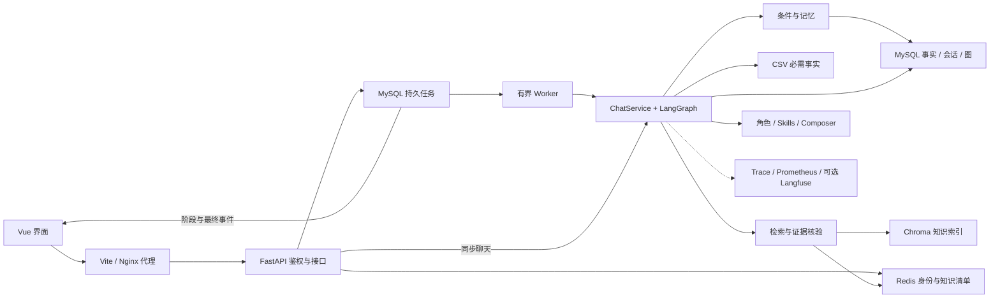
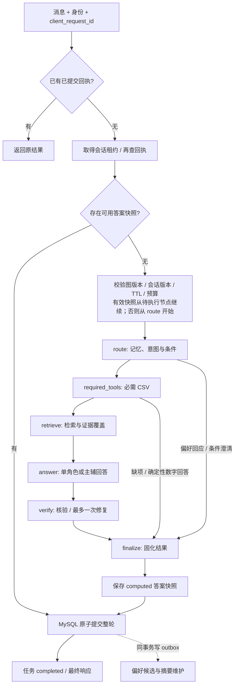

# 整体架构、模块流程与技术优化

本页按当前 `v2` 代码说明系统如何工作，也是技术讲解的主入口。部署参数见 [部署说明](DEPLOYMENT.md)，接口与扩展规范见 [开发说明](DEVELOPMENT.md)，实测结果见 [评测说明](EVALUATION.md)。

HelloHebut 面向河北工业大学本科报考咨询：政策与校园事实来自收录资料，录取数字由 CSV 工具计算，个人条件与偏好进入受控上下文。模型承担理解、检索规划、解释和语义核验，程序控制事实来源、预算、状态和提交。

## 1. 优化后的技术主线

| 优化能力 | 当前实现 | 解决的问题与适用边界 |
| --- | --- | --- |
| **LangGraph 持久工作流** | 六个显式节点，MySQL JSON Checkpointer、规则指纹、调用前保存预算 | 从已完成节点恢复；中断的外部调用仍可能重做 |
| **MySQL 事务与持久任务** | 整轮提交、幂等回执、租约 token、版本检查、事务 outbox | 重试不重复写问答，提交成功时维护事件同时入库 |
| **Agentic RAG 与证据核验** | 按问题/年份规划，混合召回与重排，缺项补查，回答独立核验 | 根据证据决定补查或说明不足；不会补造缺失政策 |
| **确定性录取工具** | 录取需求独立判断、必需 CSV 查询、风险计算与数字短路径 | 复合问题不因主意图不同而漏查数字；模型不计算录取概率 |
| **结构化状态与可验证偏好** | TaskState 字段来源、条件失效；偏好原话来源、人工确认、版本与有效期 | 换省份/考生不继承旧成绩，未确认偏好不作为事实 |
| **受控角色协作** | 默认单角色；可选一主一辅、类型化 claims、确定性 Composer | 合并重复内容、排除明确冲突；冲突检测依赖共享 fact_key |
| **渐进 Skills 与完整上下文预算** | 安全 YAML、按角色/问题选规则、按需读引用、完整轮次裁剪 | 减少无关背景；必需事实和工具交互放不下时明确失败 |
| **标准只读 MCP** | 独立 stdio Client/Server，Schema、角色、超时与输出限制 | 支持外部复用三个查询工具；在线问答仍直接调本地工具 |
| **隔离评测与可观测性** | 独立会话空间、benchmark/run manifest、元数据 Trace、逐请求指标 | 评测不污染用户状态，实验与实际配置可追溯 |

**启用状态：**正常 Compose 部署默认使用图执行、Agentic RAG、MySQL 账本与已确认偏好，回答采用单角色。主辅协作、角色工具循环、BM25 和 Langfuse 可选开启。中文 BGE 目前只在隔离实验中验证，生产知识索引仍用 MiniLM/ONNX 384 维。裸 API 的偏好开关默认值与 Compose 不同，详见部署说明。

## 2. 模块与数据分工

| 模块 | 输入 → 输出 | 代码入口 |
| --- | --- | --- |
| API 与组装 | 配置、请求、令牌 → 服务组件、任务或响应 | [api/main.py](../api/main.py)、[task_routes.py](../api/task_routes.py) |
| 聊天协调与工作流 | 消息、旧状态、请求 ID → 核验后的结果与新状态 | [chat_service.py](../core/chat_service.py)、[chat_graph.py](../workflows/chat_graph.py) |
| 条件与数字 | 显式条件、历史 CSV → 可用实体、查询记录、风险解释 | [task_state.py](../core/task_state.py)、[admission_data.py](../tooling/admission_data.py) |
| 检索与证据 | 子问题、年份、资料快照 → 带来源的证据与缺项 | [agentic.py](../rag/agentic.py)、[knowledge_base.py](../tooling/knowledge_base.py) |
| 角色与规则 | 任务、证据、条件 → 回答或结构化 claims | [agent_orchestrator.py](../agents/agent_orchestrator.py)、[skill_loader.py](../core/skill_loader.py) |
| 持久化与维护 | 结果、状态、来源 → 原子回执、偏好、摘要、可恢复任务 | [mysql_turn_store.py](../memory/mysql_turn_store.py)、[job_store.py](../memory/job_store.py)、[fact_store.py](../memory/fact_store.py) |
| 评测与观察 | 场景、调用轨迹 → 断言、评分、指标、实验指纹 | [evaluator.py](../evaluation/evaluator.py)、[runtime.py](../core/runtime.py)、[tracing.py](../monitor/tracing.py) |

MySQL 保存事实版本、对话/状态/回执、图快照和任务，是业务记录的权威来源；Redis 保存匿名会话身份与活动知识清单；Chroma 保存资料的向量索引。CSV 是录取数字依据，Skills 是运行规则。三类存储不会互相充当故障时的第二写入主库。

## 3. 启动、身份与前端交互

`lifespan()` 读取模型配置，初始化意图识别、Skills 与角色，创建 MySQL 事实/会话/图表，再组装记忆、Chroma 知识库、CSV、ToolManager 和 ChatService。评测另建编排器、工具管理器与会话空间；随后启动 JobStore worker、监控与可选 Trace 导出。

用户通过 `POST /session` 获取 Redis 中的匿名 Bearer 身份；服务端从令牌确定用户，不能由请求中的 user_id 冒充。网页使用 `POST /chat/tasks` 入队，取得 run_id，再读取 SSE。同步 `/chat` 和 CLI 仍走同一 ChatService，只有网页任务入口使用持久队列。

**优化重点：把“网络连接”与“业务执行”分开。**浏览器断线不会取消后台任务。前端保存请求 ID、run_id 和事件序号，同一请求重试或查询原任务；SSE 支持 `Last-Event-ID` / `after_sequence`，不会重复发出已经读取的 final。提交响应丢失但尚无 run_id 时，仍可用原请求 ID 找回任务。

阶段事件只显示整理问题、查资料、核验和保存进度，**不是未核验的模型 token 流**。最终答案在业务提交并完成任务后才返回。未完成请求不被不同消息覆盖；会话身份绑定后端地址，切换服务会清理原身份。条件栏支持发起更正，“新对话”只是切换会话，不等于删除记录。

## 4. 一轮聊天的执行顺序

图中六节点顺序表示新执行；有效快照恢复时跳过已完成节点。六节点是实际 LangGraph `StateGraph`，成功节点同步写 MySQL Checkpointer。`finalize` 仅固化图结果，**业务事务在图结束后由 ChatService 执行**。缺项澄清、纯偏好回应和确定性数字回答可以提前结束，不强制走完整模型链路。

### 4.1 route：条件与任务状态

先读取近期消息、摘要与已确认偏好。查询本人偏好、仅表达候选偏好时可直接给出确认/管理说明。其余请求识别意图并把当前实体合并到 TaskState；状态包含 entities、sources、revision、invalidated 和 subject_is_self。

**优化重点：用有来源的结构化字段替代仅靠历史文本猜条件。**当前更正优先；换省份、考试年度、考试方式或考生时失效不适用的分数/位次。替别人咨询不使用本人的偏好，旧摘要不能把已失效成绩重新补回来。

例如“河北物理类位次 12000，计算机怎么选？”后接“换天津考生呢？”，系统应重新确认对应成绩，而不是用河北位次直接计算天津风险。

### 4.2 required_tools：必需 CSV 与确定性计算

录取数字需求检测独立于主意图。复合问题只要需要最低分、位次或风险，先调用 CSV；多个专业分别查询，必要条件缺失则澄清。结果区分 ok、needs_clarification、unsupported、not_found、unavailable，找不到记录不等于学校不招生。

**优化重点：程序保证必要事实先到位，模型只负责解释。**风险优先比较历史最低位次、中位数、命中年份及领先比例，分数比较置信较低；阈值见 [风险计算实现](../tooling/admission_data.py)。纯数字问题用 [确定性模板](../core/admission_answer.py) 直接回答并标记 deterministic_csv，减少生成数字时的偏差和额外调用。风险等级不是录取概率或录取承诺。

### 4.3 retrieve：Agentic RAG

流程为“规划子问题 → 单次混合检索 → 证据覆盖检查 → 按缺项补查或停止”。显式年份拆成带年份过滤的查询；复杂无年份问题可由模型规划，简单问题走直接查询。

每轮最多取两个子查询**顺序执行**，全请求最多三轮、六个查询，最终最多八份证据。当前路径调用 `search_once`，Planner 统一管理查询预算，不在每个子查询内再次嵌套旧的查询改写；旧扩写并行召回只保留在兼容流程。

单次检索经过 Chroma 向量召回、词法召回、RRF 融合和 LLM 重排。默认 filtered_legacy 去掉已作为硬过滤的年份干扰，balanced 使用等权 RRF；BM25 保留为候选。线上向量仍是 MiniLM/ONNX 384 维，ONNX 用于生成文档/查询向量，**不负责大模型回答**。

证据保留文档/修订/片段 ID、原文、年份、来源与哈希。覆盖检查返回 supported_claims、missing_facts、conflicting_sources、next_queries 和 answer/retrieve_again/abstain 决策；无新证据或预算到达即停止。

**优化重点：从“检索过就回答”变为“证据是否覆盖问题”。**跨年比较缺一年政策时明确缺项；引用必须来自本次证据集合，不能将花完预算视为证据充分。

### 4.4 answer：角色、Composer 与上下文

General、Policy、Risk、Planning 四类角色按任务路由，默认只执行一个。可选 composed 模式对复杂问题最多分派一个主角色与一个辅助角色；任务范围明确，角色并行返回 status、claims、evidence_ids、missing_facts、errors。

[Composer](../agents/composer.py) 不再调用模型写一遍事实，而是按声明去重、合并有效引用、用显式 fact_key 排除冲突并说明缺项。它不能保证发现任意语义矛盾，最终结果仍进入统一回答核验。legacy_concat 仅用于直接拼接对照。

**优化重点：协作有上限、有结构化中间结果、有统一核验。**没有独立收益证据时保持单角色，不为每个简单问题增加多角色调用。

Skills 经安全 YAML 和元数据校验后，按角色与问题匹配正文；references 通过受控工具按需读取。可选模型工具循环每角色最多三次模型轮次，仅开放 request_evidence_read、skill_reference_read，读取已注册证据与当前匹配 Skill 引用，不能自行引入未知来源。

[上下文预算](../core/context_budget.py) 同时计算 system、历史、当前问题、事实背景和工具 Schema；用 UTF-8 字节作保守 token 上界，实际 token 以供应商返回值为准。保留当前问题与必需背景，按完整问答轮次裁剪历史，超大工具输出返回合法错误 JSON；无法容纳必需事实或完整工具交互则失败，不截断 CSV 或留下半个 tool_result。

### 4.5 verify 与 finalize：先核验后提交

`verify` 先进行数字、引用硬检查，再判断事实是否受原文支持。证据充分但回答未通过时最多修复一次，仍不通过则返回证据/缺项说明，状态为 insufficient_evidence。

**优化重点：生成结果不是最终权威，校验失败不能默认放行。**返回 completed 也应结合 verified、verification_method、stop_reason 理解；偏好说明或寒暄不等于通过政策事实核验。escalated 只提示咨询招生办，当前没有自动联系真人或创建工单。

## 5. MySQL 持久执行与恢复

恢复优先级为 **已提交回执 → 已计算答案快照 → 中间图状态 → 新执行**。JSON Checkpointer 实现异步 checkpoints/pending writes，不使用 pickle，不开放任意 thread 读取接口。

图按用户/会话/请求隔离，校验消息、基础 revision、工作流指纹和一小时恢复期限。指纹覆盖受控源码、依赖、Skills/参考文件、CSV 与已加载规则。模型/工具调用前持久化已用额度，同请求重启或图版本失效不会重置预算。

MySQL 会话租约 token 与 revision 阻止旧执行提交；问答两条消息、TaskState、幂等回执与维护 outbox 在同一事务中提交。`SKIP LOCKED` 用于 worker 认领任务，心跳续租，最多三次尝试；末次失联先核对正式聊天回执，有结果则恢复 completed，仍有有效会话执行租约则延后失败判定。

| 故障位置 | 实际恢复行为 |
| --- | --- |
| 浏览器断线 | worker 继续，重新读取原任务与事件序号 |
| 节点之间退出 | 有效图快照从已完成节点之后继续 |
| 节点内部外部调用中断 | 整个节点可能重入，调用额度保留 |
| 已生成答案、事务未提交 | 有效 computed 快照恢复提交，不再生成答案 |
| 已提交、任务完成标记/HTTP 响应丢失 | 从回执恢复原结果，不追加同一轮 |
| 图版本或会话 revision 不符、图 TTL 超过 | 放弃中间图状态，保留已用预算 |
| 清空会话 | 同事务取消并擦除关联任务，删除正文/图，保留防旧 Redis 复活墓碑 |

**边界：**整段检索循环是一个 retrieve 节点，修复过程属于 verify；不是每次模型调用都可独立恢复。外部调用可能再次计费。computed 已核验答案只按原 revision/TTL 恢复，不被新的图指纹重新生成；已提交回执始终回放原结果。

普通任务提交有容量限制，worker 并发有界；维护 outbox 为保证与聊天同事务会持久保留，不能声称所有队列记录均有硬容量上限。一小时图 TTL 不会自动删除历史数据，周期归档仍待完善。

## 6. 知识发布与版本治理

管理员导入资料后，先提取来源/年份/学院/专业/章节并切片，保留检索文本与展示原文；写入 Chroma 新 revision 并校验，最后用 Redis 清单 CAS 切换活动 generation。读请求固定自己的清单快照，缓存按发布代际/过滤范围区分；最近五次发布可回退。

**优化重点：检索只看到完整已发布版本，引用能回到本次实际原文。**失败写入不发布半份文档，发布中途不混代。来源域名和元数据约束不能自动证明提交正文真实，内容审核仍需人工。

## 7. 可验证记忆与异步维护

当前任务条件、对话摘要与长期偏好分开管理。长期事实仅覆盖专业、兴趣、费用、地域四类，不保存分数、位次和身份凭证。候选提取采用保守的显式原话规则，不让模型推测本人偏好。

聊天原话先原子提交，outbox 再驱动来源核对与候选捕获；捕获在会话租约内，防止清空后旧任务重新写回。用户确认后才进入后续上下文；更正/删除使用版本 CAS 与操作幂等，待确认、撤销、过期记录不参与回答。清空对话与删除已确认偏好是两项独立操作。

[摘要维护](../memory/conversation_memory.py) 先生成摘要，再比较消息前缀与摘要版本后提交裁剪。失败保留原文，避免摘要失败却删掉旧历史。旧 Redis 会话只在首次读取时懒导入尚存内容；MySQL 故障不会切回 Redis 双写。

**优化重点：记忆可解释、可确认、可纠正，不把历史对话中的一句话自动当长期事实。**匿名身份目前仍为 24 小时，跨设备账号恢复与周期存储清理属于后续工作。

## 8. 本地工具与标准 MCP 的关系

在线 ChatService 直接调用 [ToolManager](../tooling/tool_manager.py)：校验参数 Schema、工具范围、缓存与调用预算，处理超时、错误和熔断；半开状态限制单探针。类名仍为 MCPToolManager，但这个名字不意味着每次调用经过 MCP 协议。

独立 [MCP Server](../tooling/mcp_server.py) / [Client](../tooling/mcp_client.py) 通过真实 stdio initialize/list/call 提供 knowledge_search、admission_data_query、data_version_stats。客户端固定服务器命令和环境白名单，检查输入/输出 Schema、角色、超时与大小，服务端只读。

**优化重点：把本地工具抽象与标准协议明确区分。**需要跨进程复用时接 MCP，线上短链路不额外增加协议往返；请求私有工具、偏好管理和知识写入不对外暴露为公共 MCP 工具。

## 9. 评测、观测与持续改进

评测复用 ChatService 但使用独立模型编排/工具组件和 MySQL 命名空间，每次场景执行生成独立身份，防止并发评测互相清空。影子请求 persist_memory=false 使用内存图，不读取或隐式初始化真实记忆；正式多轮评测在隔离库保留本场景状态并清理。

benchmark_id 固定用例、真值、评分与 Judge 配置；run_manifest 记录实现、模型、Skills、检索配置与资料发布前后状态。离线断言、存储故障测试、真实模型冒烟、开发集消融和独立人工验收分开报告，不能互换准确率含义。

Trace 记录阶段、耗时、调用数、token、核验结果和停止原因；Prometheus 按每请求记录延迟，区分交互/评测。可选 Langfuse 导出允许的 OTLP 元数据；MySQL 图快照包含实际业务内容，不能当作脱敏 Trace 分享。费用只有配置单价后才估算，未返回的调用用量可能缺失。

**优化重点：从只看回答文本，扩展到可复现的状态、证据、工具和故障轨迹。**错误进入回归用例，再比较候选改动，人工审阅后发布；当前没有自动改线上提示词、规则或评分标准的自优化流程。成果与尚未通过的门槛统一见 [评测说明](EVALUATION.md) 和 [后续路线](ROADMAP.md)。
