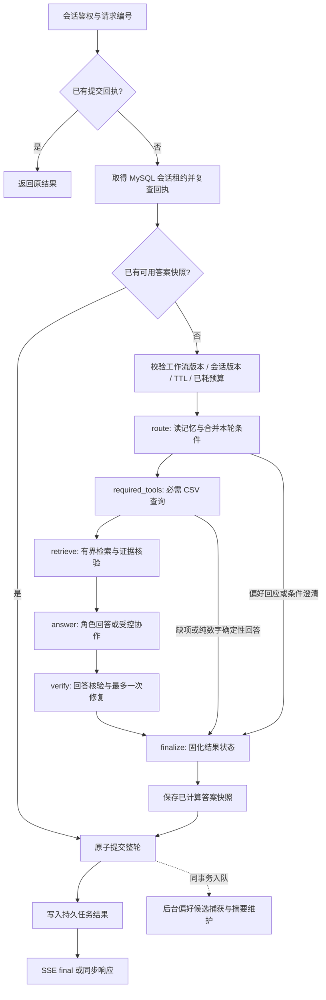
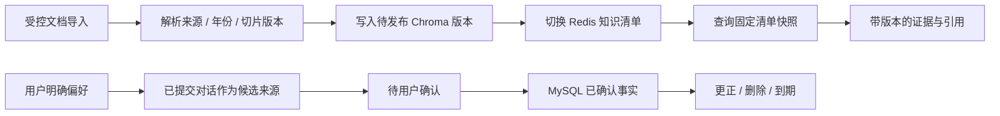

# HelloHebut v2 主要流程

本页说明当前代码的执行顺序。技术职责与可靠性约束见[技术实现](TECHNICAL_DESIGN.md)，启动、配置和验收入口统一见 [v2 实施与验证指南](experiments/v2/README.md)，避免在流程文档重复维护命令与测试结果。

## 1. 服务与入口

`api/main.py::lifespan()` 组装模型客户端、意图识别、Skills、工具管理器和 ChatService；初始化 MySQL 事实库、对话账本、图检查点与任务表，连接 Redis 和 Chroma，并加载 CSV。随后启动持久任务 worker、监控和可选 Trace 导出。评测使用独立编排器、工具管理器和会话命名空间。

网页经 Nginx/Vite 代理访问 FastAPI。调用方先通过 `POST /session` 获取匿名 Bearer 会话；身份由服务端令牌确定，传入 `user_id` 不能替代鉴权。

| 入口 | 执行方式 |
| --- | --- |
| `POST /chat/tasks` | 写入 MySQL 任务队列，返回 `run_id`；worker 调用 ChatService |
| `GET /chat/tasks/{run_id}/events` | SSE 返回安全阶段事件；支持 `Last-Event-ID` / `after_sequence` 续读 |
| `POST /chat` | 同步调用同一 ChatService，保留兼容入口 |
| `POST /eval/jobs` | 管理员提交持久评测任务，可查询状态与结果 |

聊天任务按用户、会话和 `client_request_id` 幂等。相同编号与不同消息冲突；任务查询和 SSE 只允许所属身份访问。

## 2. 一轮聊天的主路径

图中六个节点由真实 LangGraph `StateGraph` 连接，成功节点同步写入 MySQL Checkpointer。`finalize` 只固化工作流结果；业务提交仍由 ChatService 在图完成后执行。

### 条件与短路径

`route` 读取近期消息、摘要和已确认偏好，把本轮显式实体合并到持久 `TaskState`。当前更正优先于历史；省份、年份、考试方式或咨询对象改变时，失效不再适用的分数、位次等条件。替别人咨询时不套用用户本人的长期偏好。

必需 CSV 查询独立于主意图和角色选择：复合问题只要包含录取数字或风险需求，就先尝试确定性数据源。缺省份、科类、专业等关键条件时先澄清；工具不可用或不覆盖时返回明确状态。纯数字问题可直接使用 CSV 模板完成，不额外调用回答模型。

### 证据到回答

`retrieve` 内部执行有限的“规划子查询 → 检索 → 检查证据是否充分 → 按缺项补查”。年份、来源版本、引用 ID 和缺失事实随证据保留；达到预算或没有新证据时停止。

`answer` 默认选择一个角色。启用协作后，复杂问题最多使用主角色和一个辅助角色，结构化结果交给 Composer 去重、保留来源、排除冲突结论。可选工具循环只读取本请求已注册证据和当前激活 Skill 的参考文件，不自行扩大证据集合。

`verify` 对最终文本执行数字、引用和语义支持检查。证据足够但回答不合格时最多修复一次；仍不合格则返回证据片段和缺项说明。`verified`、`status` 和 `stop_reason` 表示本轮实际结果；收到最终响应不等于所有问题都有充分证据。

## 3. 提交、断线与恢复

整轮用户消息、最终回答、业务状态、请求回执和维护任务 outbox 在同一 MySQL 事务中提交。提交前校验会话租约 token 和版本，避免过期 worker 写入。后台 job 完成后，SSE 才发送携带答案的 `final`；此前只发送阶段、序号与状态，不流式展示未核验草稿。

| 中断位置 | 后续行为 |
| --- | --- |
| 仅浏览器断线 | 后台任务继续；按事件序号续读或查询任务结果 |
| 节点之间进程退出 | 新 worker 取得有效租约后，从已完成节点之后继续 |
| 节点内模型/工具调用中断 | 该节点可能重入；已预留调用额度保留 |
| 图完成、业务提交之前 | 优先复用已计算答案快照；否则读取图的最终状态 |
| 提交完成、响应丢失 | 请求回执优先，返回原结果，不重复追加问答 |
| 工作流版本、会话版本或恢复 TTL 不匹配 | 废弃旧中间图状态；同请求已耗预算仍保留 |

恢复粒度是节点，不是模型调用的 exactly-once。整个 Agentic RAG 循环处于 `retrieve` 节点内；节点中途崩溃会重新执行该节点。调用数在外部执行前落库，但崩溃时未收到的供应商 token 用量无法准确补记。

图节点的版本校验不重算已经完成核验的答案快照：该快照仍按原有会话版本和有效期约束恢复提交；已提交回执始终返回原结果。

`DELETE /conversations/{conv_id}` 在事务内清空会话与图状态，并取消、擦除相关聊天和维护任务内容；旧任务重新入队保持取消状态。运行中的 worker 在取得会话租约后及提交前复核任务 token。清空聊天与管理已确认偏好是两个独立操作。

## 4. 知识与长期偏好的维护

知识发布先写入待发布版本再切换清单，读请求只使用自己的清单快照；失败发布不会把半份资料暴露为当前版本。检索缓存随资料版本区分。导入来源约束不等于自动验证网页与提交正文完全一致。

偏好候选必须有属于当前用户的已提交来源。后台捕获在会话租约内核对回执，防止与清空操作交错；用户确认前不会作为长期事实注入。摘要维护使用消息前缀与摘要版本的比较更新，失败不裁剪原始历史。

## 5. 评测与运行观测

离线回归验证确定性规则；真实 MySQL/Redis 检查验证事务、租约、故障恢复和任务隔离；真实模型评测另行判断回答质量与成本。`persist_memory=False` 使用内存图，不写生产会话与长期偏好；需要多轮状态的评测使用独立会话库。

本地 Trace 记录阶段耗时、工具/模型调用、token、核验结果和停止原因。可选 Langfuse connector 通过 OTLP/HTTP JSON 导出允许的元数据，不导出用户身份、问答正文、偏好值或隐藏推理。Prometheus 区分交互与评测请求；`/live` 检查进程，`/ready` 检查 MySQL、Redis 和 Chroma。

验收命令、报告索引、实验限制和未证明的效果集中维护在 [v2 实施与验证指南](experiments/v2/README.md)。
