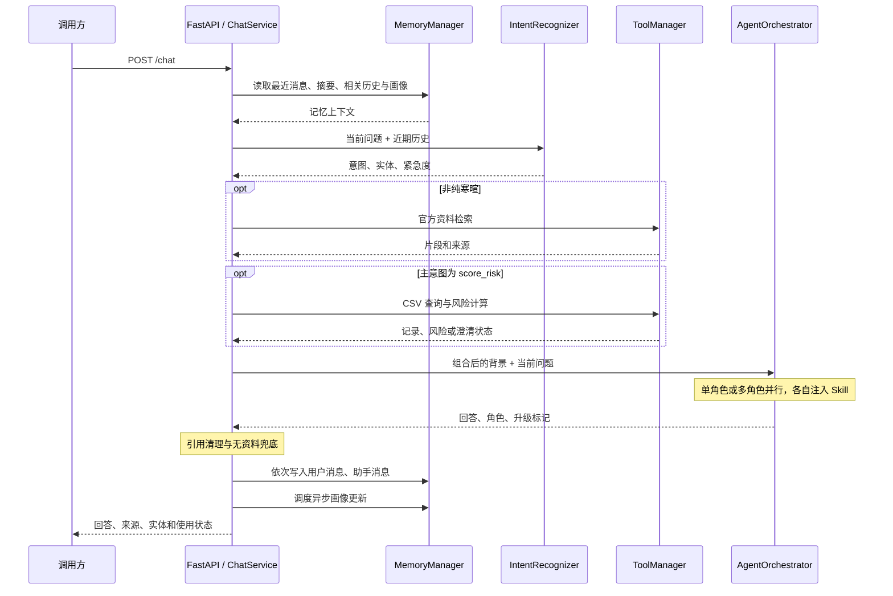

# HelloHebut 主要流程

本页记录 v1 流程基线；`v2` 的阶段进度与运行方式见 [v2 实施与验证指南](experiments/v2/README.md)。

本文按执行顺序说明系统，算法与参数见 [技术实现](TECHNICAL_DESIGN.md)，运行命令见 [部署文档](DEPLOY.md)。

## 1. 服务启动

入口为 `api/main.py::lifespan()`：

1. 读取模型配置，创建意图识别器、SkillManager 和线上 AgentOrchestrator。
2. 连接 Redis 与 ChromaDB，创建 MemoryManager 和知识库，导入内置摘要并扫描部署资料。
3. 加载并校验 CSV，注册 `knowledge_search`、`admission_data_query` 两个本地工具。
4. 组装线上 ChatService，启动性能监控。
5. 创建独立的评测编排器、工具管理器与 ChatService，再接入评测器。

网页经 Vite（开发）或 Nginx（部署）把 `/api/python/*` 转发为后端根路径。完整功能使用 HTTP `/chat`；CLI 直接调用编排器和记忆，未接入完整的 RAG、CSV 与引用后处理。

## 2. 一次聊天

### 2.1 请求时序



### 2.2 关键分支

| 阶段 | 当前行为 |
| --- | --- |
| 身份与会话 | 缺少 `conv_id` 时生成新会话；缺少 `user_id` 时使用与会话绑定的匿名标识 |
| 记忆与意图 | 最近 5 条消息传给意图识别器；摘要、相关历史、画像和最近对话另组成 Agent 背景 |
| 事实准备 | 先尝试 RAG，再在主意图为 `score_risk` 时查询 CSV；工具解析出的字段补回实体集合 |
| 请求组装 | 背景顺序为记忆 → CSV → 官方知识 → 实体 JSON；当前问题单独发送 |
| Agent 执行 | 根据意图与领域关键词选择角色，注入 Skills；协作与失败处理见[路由规则](TECHNICAL_DESIGN.md#22-角色路由与协作) |
| 引用与兜底 | RAG 来源去重编号后追加 CSV 来源；删除正文越界编号；指定事实型意图无资料时覆盖回答 |
| 记忆写入 | 用户与最终回答分别写入 Redis，写入时可能触发压缩；画像单独异步更新 |

CSV 的触发条件独立于协作角色列表：即使 Risk 参与回答，主意图不是 `score_risk` 时也不会查询 CSV。

返回 `conv_id`、`response`、`intent`、`agent_type`、`escalated`、`latency_ms`、`knowledge_used`、`admission_data_used`、`citations`、`entities`。`admission_data_used` 表示得到有效分析或候选专业；`knowledge_used` 表示使用了有效 RAG 或 CSV 结果。

## 3. 知识库导入与查询

### 3.1 导入

```text
内置摘要 / 部署目录 / 管理接口
    → 解析正文和来源元数据
    → 识别学院、专业与章节，切分正文
    → 生成 index_text 与 raw_content
    → Chroma 向量化并 upsert
    → 部署目录更新成功后清理该文件旧版本
```

知识集合默认名为 `hello_hebut`。2026-11-10 本地资料快照为：8 条内置摘要 + 15 份学院文档生成的 197 个片段，共 205 个片段；运行时数量以 `GET /knowledge/stats` 为准，CSV 不计入其中。

部署扫描支持 TXT、MD，以及单对象、数组或含 `documents` 数组的 JSON。默认类别为 `major_info`，从文件名提取年份，用文件 SHA256 和索引版本判断是否需要更新。管理接口导入和部署扫描的来源要求、覆盖行为有所区别，见[索引与来源](TECHNICAL_DESIGN.md#31-索引与来源)。

### 3.2 查询

```text
原始问题 + LLM 改写
    → 多个子查询并发调度
    → 类别池 / 全库池内分别进行向量与关键词召回
    → 加权 RRF 融合与候选交错
    → 多查询轮询合并、去重
    → LLM 重排和阈值过滤
    → ChatService 组织资料与引用
```

召回配额、融合公式和重排参数统一见[召回与重排](TECHNICAL_DESIGN.md#32-召回与重排)。`/search` 只执行全库检索；`/chat` 额外包含意图、类别优先、条件式 CSV 查询和 Agent 回答。

## 4. 录取风险与多轮示例

CSV 本地快照覆盖河北、天津的 2023—2025 年：507 条记录，其中 447 条分数和位次均完整、60 条不完整，共 84 个不同专业名称。以 `GET /admission/stats` 返回的实际版本为准。

```text
本轮问题 + 实体 + 近期用户消息
    → 补全省份、科类、分数、位次、专业与年份
    → 专业别名归一化和歧义检查
    → 精确过滤 CSV
    → 计算历史中位数、位次差与风险等级
    → RiskAgent 解释结果或补问缺失信息
```

输入“河北物理类位次12000，计算机专业风险如何”，工具将专业归一化为“计算机科学与技术”：

| 年份 | CSV 最低分 | CSV 最低位次 | 历史最低位次 − 考生位次 |
| --- | --- | --- | --- |
| 2023 | 608 | 12287 | 287 |
| 2024 | 607 | 12449 | 449 |
| 2025 | 621 | 13587 | 1587 |

三年均达到历史最低位次，中位位次为 12449；领先幅度 `(12449 - 12000) / 12449 ≈ 3.61%`，未达到“相对稳妥”的 8% 门槛，因此为 **相对匹配**。完整公式和工具状态见[风险规则](TECHNICAL_DESIGN.md#4-csv-风险计算与多轮字段)。

随后问“电气呢”时，复用同一用户和会话；若识别为 `score_risk`，工具会从近期用户消息补充先前条件。只提供位次、不指定专业时还可返回候选专业，再指定专业查看逐年记录。这些是历史数据比较，不是未来录取预测。

## 5. 记忆写回

```text
最终回答确定
    → 写入用户消息
    → 写入助手消息
    → 每次写入检查是否需要压缩旧消息
    → Redis 保存摘要与保留消息，Chroma 保存情景摘要
    → 单独调度画像提炼、合并与 upsert
```

压缩发生在当前请求的写入过程中；只有画像更新异步调度。存储键、容量、TTL、画像合并和并发限制集中在[记忆与可靠性](TECHNICAL_DESIGN.md#5-记忆缓存与执行可靠性)。

## 6. 评测流程

```text
POST /eval/run
    ├─ 意图用例 → IntentRecognizer → 标签指标
    └─ 对话用例 → 评测 ChatService → 与线上相同的业务链路
                     → LLM Judge + 确定性断言
    → 汇总报告、回归比较、写入 latest.json
    → 同步返回报告
```

每个对话场景默认创建专用用户与会话，开始和结束时清理短期记忆，关闭画像更新。评分标准、隔离范围、默认用例规模和基线口径见[评测说明](TECHNICAL_DESIGN.md#6-评测方法与结果口径)；实际请求示例见[部署验证](DEPLOY.md#5-部署验证)。
